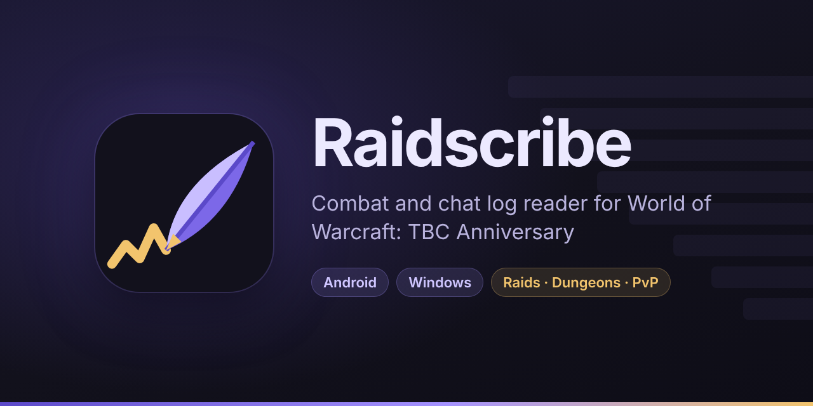

<p align="center">
  
</p>

Raidscribe reads your World of Warcraft combat and chat logs and turns them into easy-to-read summaries. It runs on your Android phone and on your Windows PC, and it's made for **TBC Classic Anniversary**.

- **Every raid and dungeon run:** bosses killed, wipes, clear time, and everyone's damage and healing.
- **Tap a player** to see their deaths and what killed them, the consumables they used (by exact name), cooldowns, interrupts and damage taken.
- **Fight by fight:** every pull, with meters, deaths and the chat during that fight.
- **History:** week-by-week recaps, boss kill times, player trends, attendance and loot.
- **Chat:** loot, rolls with the winner worked out, a watch list for words you care about, and all messages, searchable.
- **Sharing:** copy a summary for Discord, share a picture of it, or save a full report.

On the PC it updates live while you play.

> **Beta:** this is **Raidscribe 1.0.0-beta**, the first public version. Everything works, but expect rough edges. The version and build number are in **Settings → About**.

## Install

Download the latest version from [**Releases**](../../releases).

**Windows PC**

1. Download `Raidscribe-Setup-….exe` and open it.
2. Windows may say **"Windows protected your PC"**, because Raidscribe isn't code-signed yet. Click **More info**, then **Run anyway**.
   - If it says **"An Application Control policy has blocked this file"** instead, Windows' Smart App Control is on, and it blocks every app that isn't code-signed. Turn it off in **Windows Security → App & browser control → Smart App Control settings**, then run the installer again. On an up-to-date Windows 11 you can turn it back on afterwards.
3. Click through the installer. It doesn't need admin rights, and you can uninstall Raidscribe any time from **Settings → Apps**.

Raidscribe finds World of Warcraft by itself. If it can't, it asks you to choose your World of Warcraft folder or pick one of your log files.

**Android phone**

1. Download `Raidscribe.apk` on your phone and open it. If Android asks, allow your browser or Files app to install apps, then tap **Install**.
2. Open Raidscribe, tap **Allow access**, switch on **Allow access to manage all files**, and go back. Raidscribe uses this to read the log files you copy onto your phone.

## 1. Turn on logging in game

Type these in the WoW chat box each time you log in:

```
/combatlog
/chatlog
```

WoW confirms each one in chat. Type the same command again to turn it off.

For the most detail, also turn on **Advanced Combat Logging** once: **Options → Network → Advanced Combat Logging**.

> WoW only finishes writing the chat log when you log out, so log out (or exit the game) before copying it to your phone.

**On the PC, that's all.** Raidscribe reads the logs as WoW writes them. The steps below are for the phone.

## 2. Copy the logs to your phone

The logs are on your PC in:

```
World of Warcraft\_anniversary_\Logs
```

You need the `WoWCombatLog-….txt` files and `WoWChatLog.txt`. To get them onto your phone, use either of these:

- **USB cable:** plug in your phone and choose **File transfer** on the phone. On the PC, open the phone's **Internal storage**, make a folder called `Raidscribe`, put a folder called `Logs` inside it, and copy the logs in.
- **Any cloud or sync app** that saves files to your phone's storage, such as the Download or Documents folder.

## 3. Pick the folder in the app

1. In Raidscribe, tap the menu button (☰) and open **Settings**.
2. Under **Logs folder**, tap **Choose folder…**.
3. Open the folder with your logs and tap **Use this folder**.

Raidscribe reads every log in that folder. Logs you copy in later are picked up on their own, even with the app open. Settings shows how many logs it's reading.

On the PC, you can change the folder the same way: **Settings → Logs folder → Choose WoW folder…** or **Pick a log file…**.

## Licence

Raidscribe is free software: you can share it and change it under the [GNU General Public License 3.0](LICENSE). It comes with no warranty.

## Credits

Raidscribe uses this open-source software and data:

| Software / data | Used for | Licence |
|---|---|---|
| [wow-classic-items](https://github.com/nexus-devs/wow-classic-items) | Item names, qualities and tooltips | MIT |
| [cMaNGOS TBC database](https://github.com/cmangos/tbc-db) | Consumable item data: item and spell IDs | GNU GPL 3.0 |
| [Python](https://www.python.org/) | The log reader | PSF License Agreement |
| [Inter](https://github.com/rsms/inter) | Typeface (phone) | SIL Open Font License 1.1 |
| [Chaquopy](https://github.com/chaquo/chaquopy) | Running Python on Android (phone) | MIT |
| [AndroidX Core](https://developer.android.com/jetpack/androidx) | Sharing files with other apps (phone) | Apache License 2.0 |
| [Tcl/Tk](https://www.tcl-lang.org/) | The window and its drawing (PC) | Tcl/Tk License |
| [PyInstaller](https://pyinstaller.org/) | Packing the PC app into `Raidscribe.exe` (PC) | GPL 2.0 with the bootloader exception |

Full licence texts are in the apps: **Settings → About** on the phone, and **Settings → About → View licences** on the PC.

World of Warcraft® and Blizzard Entertainment® are trademarks or registered trademarks of Blizzard Entertainment, Inc. in the U.S. and/or other countries. Raidscribe is an independent project and is not affiliated with or endorsed by Blizzard Entertainment.
